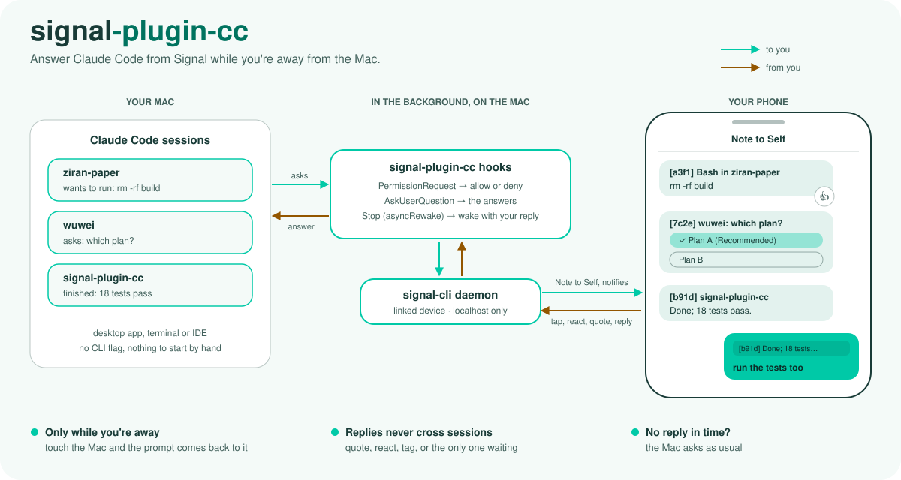

<p align="center"><picture>
    <source media="(prefers-color-scheme: dark)" srcset="docs/diagram-dark.svg">
    <source media="(prefers-color-scheme: light)" srcset="docs/diagram-light.svg">
    
</picture></p>

# signal-plugin-cc

[](https://github.com/taoq-ai/signal-plugin-cc/actions/workflows/tests.yml)

Answer Claude Code's permission prompts and questions from Signal when you're away from your Mac.
It works in any Claude Code session (desktop app, terminal, IDE) because it is a set of hooks, not a CLI mode.

- **Permission prompts:** the bot sends you the tool and its command or file. React 👍 or reply `y` to allow;
  react 👎 or reply `n` to deny, or reply anything else to deny and tell Claude why ("use the test database").
- **Questions (AskUserQuestion):** the bot sends the questions with their options, plus a poll per question.
  Tap the poll, quote a question's poll with an option number, its label or your own answer, or reply one line
  per open question. Answers can come in any order; after the last one you get a ✓ receipt and the polls close.
- **Plan approval (ExitPlanMode):** the bot sends the plan (the first 1500 characters of a longer one, with its
  length) and a poll: approve and keep asking before each edit, approve and auto-accept edits, or keep planning.
  React 👍 or reply `y` to approve with edits still asked; react 👎 or reply `n` to keep planning, or reply what to
  change and Claude keeps planning with your reply as feedback.
- **Conversation:** when a session finishes a turn while you're away, its last message comes to Signal. Reply
  (quote it if several sessions wrote) and the session wakes with your reply as its next instruction, then
  answers you the same way. Typing at the Mac or closing the session stops it listening.

It only relays while you're away: if your Mac has had keyboard or mouse input in the last 60 seconds, Claude Code
shows its normal prompt. If you come back while a prompt is waiting on Signal, it hands the prompt back to the Mac.
No reply within 5 minutes also hands it back. Without a config file the plugin does nothing.

## Setup

1. Install signal-cli (it brings Java) and qrencode:

   ```bash
   brew install signal-cli qrencode
   ```

2. Link signal-cli to Signal. Pick one:

   **Your own number (simplest).** signal-cli becomes a linked device on your account, and prompts arrive in
   Note to Self, sent so that your phone still notifies. Like any linked device, signal-cli then receives your
   messages and stores them in `~/.local/share/signal-cli`. This opens the QR code in Preview; scan it from
   Signal → Settings → Linked devices → Link new device:

   ```bash
   L="$TMPDIR/signal-link.txt"; signal-cli link -n "Claude relay" > "$L" 2>&1 & until grep -q sgnl:// "$L" 2>/dev/null; do sleep 1; done; qrencode -o "$TMPDIR/signal-link.png" "$(grep -o 'sgnl://[^ ]*' "$L")" && open "$TMPDIR/signal-link.png"; wait; cat "$L"
   ```

   **A separate bot number.** The bot messages you like any contact and never sees your own messages. You need
   a second number that can receive an SMS (a prepaid SIM) or a call (a landline); Signal blocks many VoIP
   numbers. Signal requires a captcha: open https://signalcaptchas.org/registration/generate.html, solve it,
   then right-click "Open Signal" and copy the link (clicking it hands the token to Signal Desktop instead).

   ```bash
   signal-cli -a +BOTNUMBER register --captcha 'signalcaptcha://...'
   signal-cli -a +BOTNUMBER verify CODE
   signal-cli -a +BOTNUMBER setPin YOUR-PIN
   signal-cli -a +BOTNUMBER updateProfile --given-name Claude
   ```

3. Write `~/.config/signal-plugin-cc/config.json`:

   ```json
   {"owner": "+YOURNUMBER"}
   ```

   With a bot number, add `"bot": "+BOTNUMBER"`. Optional keys: `wait` (seconds to wait for a reply, default
   300, at most 3500), `idle` (seconds without input before the Mac counts as unattended, default 60), `listen` (seconds a
   finished session waits for your reply, default 3600), `port`
   (signal-cli daemon port, default 8299), `signal_cli` (path to signal-cli). Only replies from `owner` are read.
   A misspelled or missing key is reported on stderr and turns the plugin off.

4. Install the plugin in Claude Code:

   ```
   /plugin marketplace add taoq-ai/signal-plugin-cc
   /plugin install signal@signal-plugin-cc
   ```

5. Start a new session. It starts the signal-cli daemon if it isn't running (log in
   `~/.config/signal-plugin-cc/daemon.log`). With a bot number, the first message may land in Signal's
   message requests; accept it.

## Several prompts at once

Send `status` at any time to see what is waiting for you.

Each prompt starts with a tag like `[a3f1]`. A reply never reaches the wrong session: it counts for a prompt only
when it quotes one of the prompt's messages (swipe to reply), reacts to it, starts with its tag, or is a plain
reply while that prompt is the only one waiting and the latest message. Any other plain reply gets one hint that
lists the waiting prompts.

## Security

Anyone who can send messages as `owner` can approve tool calls and plans in your sessions. Keep registration
lock on for your number (and the bot's). Plans are relayed: their text goes to Signal, and a vote for
"auto-accept edits" puts that session in accept-edits mode, so its file edits stop asking. Every other approval
from Signal keeps the per-edit prompts.

## Limits

- A session that finished more than `wait` seconds (5 minutes) before you left the Mac doesn't write to you;
  it assumes you saw its result. Closed sessions can't be reached.
- While a prompt waits on Signal, the Mac doesn't show it; touching the keyboard or mouse hands it back.
- Idle detection is macOS only. Elsewhere every prompt goes to Signal first, so lower `wait`.
- signal-cli is an unofficial client; a Signal protocol change can break it until signal-cli updates.
- Signal deregisters accounts that stay unused for a long time; keep at least one session running now and then.

## Architecture

Ports and adapters. Each layer imports only from the layers above it in this list, and
`tests/test_architecture.py` fails on any import that points outward.

| Layer | Holds |
|---|---|
| `signal_cc/domain` | The rules, with no I/O: which prompt a reply belongs to (`routing`), how replies read as answers (`forms`), what the relay says (`texts`). |
| `signal_cc/ports.py` | What the use cases need: `Messenger`, `Registry`, `Presence`. |
| `signal_cc/app` | The use cases: ask the owner, continue a finished session, answer `status`. |
| `signal_cc/adapters` | signal-cli over HTTP, state files under the config home, macOS idle time, the relay's processes. |
| `signal_cc/entry` | The Claude Code hooks and the desk, and `wiring.py`, the one place that picks and builds adapters. |

Domain and use-case tests run against in-memory fakes; adapter tests run against a stub signal-cli daemon.

## Development

```bash
python3 -m unittest discover -s tests
```

The diagram is drawn by `docs/diagram.py`; edit it and run `python3 docs/diagram.py`.
